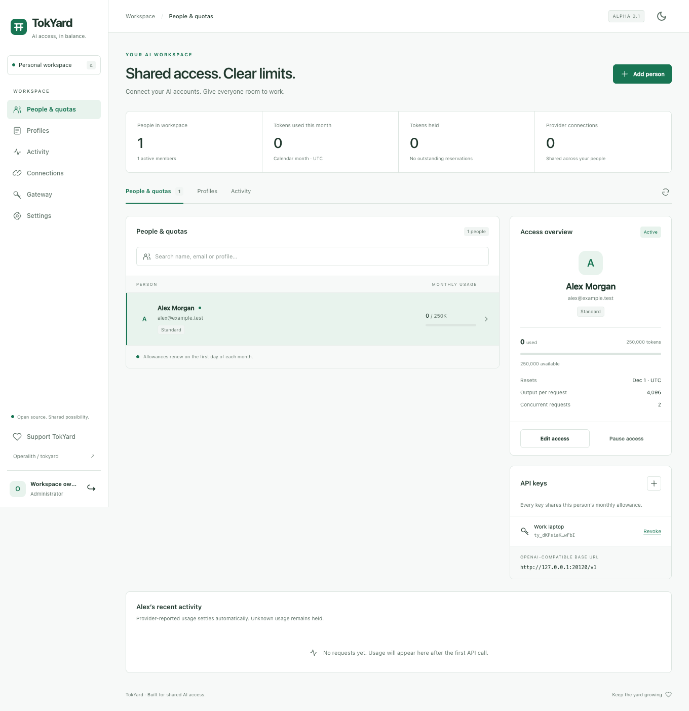

# TokYard

**Shared AI accounts. Individual token allowances.**

TokYard is a self-hosted AI gateway for small teams. Connect provider accounts once, create people and access profiles, then give each person their own API keys, monthly token budget and optional daily cap.

An independent MIT-licensed fork of [9router](https://github.com/decolua/9router), maintained by [Operalith](https://github.com/Operalith).

> **0.1 alpha:** working user management and token accounting, with a new Workspace interface. Use one server process and a persistent local SQLite database. This is not a production billing platform or a claim of support for every inherited provider.



## What works

- Owner and member sign-in, with separate permissions.
- Profiles with monthly allowances, optional daily caps, model allowlists, concurrency limits and output caps.
- Usage-only profiles that track each person's tokens without daily, monthly or shared token budgets.
- Individual allowance overrides, immediate pause/resume and password resets by the owner.
- Multiple API keys per person, sharing one allowance. Member secrets are shown once and stored as SHA-256 hashes.
- Reservations before upstream calls, automatic settlement from provider-reported usage, and a request ledger.
- Held budgets for interrupted or unverifiable requests, with audited owner reconciliation.
- Responsive Workspace dashboard, light/dark themes and a personal member view.
- Inherited provider connections and OpenAI / Anthropic / Responses translation.
- Owner Token Saver controls (RTK, Headroom and prompt options), plus a Tools directory for advanced gateway pages.
- A Bitcoin support page with a receiving address, QR code and wallet link.

## Installation

Use **Node.js 24 LTS** and npm. The built-in `node:sqlite` driver needs no separate database service. Node.js 22.18+ is also accepted; Node 24 is the tested runtime.

```sh
git clone https://github.com/Operalith/tokyard.git
cd tokyard
npm ci
cp .env.example .env
openssl rand -base64 24
```

Put the generated value in `INITIAL_PASSWORD` in `.env`, then run:

```sh
npm run build
npm start
```

Open [http://localhost:20120](http://localhost:20120), choose **Workspace owner**, and sign in with `INITIAL_PASSWORD`. There is no built-in default password. A random signing key is generated in `DATA_DIR/jwt-secret` if `JWT_SECRET` is empty. Preserve it with your data.

`DATA_DIR` defaults to `~/.tokyard` (`%APPDATA%/tokyard` on Windows). The sample `.env` uses `./.tokyard`. TokYard does not automatically read an existing 9router data directory. Do not point two running gateways at the same directory.

For development, `npm run dev` serves port **20120**. Use a separate `DATA_DIR` for development.

### Docker

The Compose file builds local source; no prebuilt TokYard image is advertised yet.

```sh
cp .env.example .env
# Set INITIAL_PASSWORD in .env first.
docker compose up --build -d
```

Compose binds `127.0.0.1:20120` and stores data in the `tokyard-data` volume. Put a trusted reverse proxy with HTTPS in front of remote access. Set `AUTH_COOKIE_SECURE=true` when using HTTPS. Provider credentials are sensitive; protect the host, database, signing key and backups.

## First workspace

1. Open **Connections** and add your provider accounts. OAuth availability and account-sharing rules depend on the provider. A consumer subscription does not automatically grant API or resale rights.
2. Open **Profiles** and set a monthly allowance, optional daily allowance, output cap, concurrency limit and optional model allowlist. Leave the daily allowance empty for no daily cap; set it to `0` to stop new requests. In **Allowed models**, uncheck **Allow all direct text models**, search your active connections' direct text models and select up to 200. Saved selections remain visible if a connection becomes unavailable. Check **Allow all direct text models** to remove the model restriction.
3. Open **People & quotas**, add a person with their email and a temporary password of at least 12 characters, and assign a profile. Share credentials securely.
4. Create an API key in that person's access panel, or let them sign in as **Member** and create their own. Member keys start with `ty_`.
5. Configure their client with base URL `http://localhost:20120/v1` and their member key.

```sh
curl http://localhost:20120/v1/chat/completions \
  -H "Authorization: Bearer $TOKYARD_API_KEY" \
  -H 'Content-Type: application/json' \
  -d '{"model":"openai/gpt-4.1-mini","messages":[{"role":"user","content":"Hello"}],"max_tokens":100}'
```

Use a model you connected and allowed. The example does not provision an OpenAI account or make a paid call during installation.

## How allowances work

Allowances count **input + output tokens**, including cache input. Each user has a monthly allowance and an optional daily cap, shared across every one of their keys and provider accounts. Every request must fit both limits. The same usage counts toward both periods; tokens are not charged twice. Profile changes affect existing users unless an individual allowance override is set. In **Edit access**, leave a personal limit empty to inherit the profile. Lowering a limit preserves earlier consumption and outstanding holds.

Increasing a profile allowance applies to existing keys immediately, without restarting or signing in again. Changing a monthly limit from 10,000 to 25,000 after consuming 10,000 leaves 15,000 available, minus any held tokens; it does not add 25,000 credits. The dashboard labels profile inheritance and personal overrides. Insufficient-allowance errors include the effective limit, used and held tokens, remaining balance, and minimum reservation needed for that request. A large conversation can still exceed the new balance: shorten its history or raise the effective limit.

Daily totals come from the existing request ledger, so enabling a daily cap includes usage and holds already recorded today. Existing profiles start without a daily cap. Unused daily allowance does not carry forward.

### Fixed and shared profile budgets

Profiles start in **Fixed** mode: every person has a separate allowance. In **Edit profile → Usage policy**, choose **Shared** to let everyone on that profile draw from one pool. Set a **Shared monthly token allowance**, a **Shared daily token allowance**, or both. Empty means no pool cap for that period; at least one pool limit is required. A limit of `0` stops new pool requests. Different profiles have separate pools.

The existing monthly/daily allowances are still **maximums per person**, including all pool use. Personal overrides still apply and cannot bypass the pool. For example, a 20,000-token pool and a 20,000-token maximum per person allow one member to use 2,000 and another to use 18,000. A member with a 10,000 personal maximum still stops at 10,000; raise that maximum if they may borrow more of the pool. There is no fixed slice held aside for each person: access is first come, first served. Use Fixed mode when individual shares must stay separate. Unused daily/monthly pool tokens do not carry forward.

Every reservation must fit personal and shared daily/monthly balances in the same SQLite transaction. Held tokens reduce pool availability until reliable settlement or owner reconciliation. The profile card and member access panel show pool usage, held tokens and remaining balances; the member panel also shows the amount available after applying all limits. Members see aggregate pool totals, without other members' private records.

Enabling sharing includes requests already made on that profile during the current period, including requests made in Fixed mode. Changing limits or switching modes never clears usage. Each request keeps its original profile, day and month: moving a person to another profile or receiving late usage does not move earlier charges or holds into the new pool. During the first upgrade, old requests without a profile snapshot are assigned once to their user's profile at upgrade time; older profile membership cannot be reconstructed from those rows. The migration preserves keys, counters and requests and takes the existing pre-schema safety backup.

Before dispatch, TokYard reserves a conservative text-input allowance (UTF-8 request bytes plus 2,048 tokens of overhead) and the clamped output allowance. The reservation is committed in a SQLite transaction before contacting a provider. Requests that do not fit receive **429**. Small remaining balances may not admit another request even when the final usage would be smaller.

Reliable provider usage settles the reservation to its reported total. A request rejected locally before dispatch settles to zero. Missing usage, interruption, restart or more than one upstream attempt keeps the reservation **held for review**. The owner can reconcile held requests using provider logs and a recorded reason. Restart never automatically refunds unknown provider usage.

A late response settles against its original day and month. Daily limits reset at 00:00 UTC; monthly limits reset at 00:00 UTC on the first day of the month. Holds from an earlier day still affect their original monthly allowance. The dashboard shows the latest 100 requests; older ledger rows remain in the database and count toward daily totals.

This is admission control with conservative reservations, **not an external provider spending guarantee**. A provider may tokenize differently, inject context, ignore output caps or report more tokens than reserved. Reported totals are recorded even if that exceeds the current allowance; new requests then stop. Provider invoices and rate limits remain authoritative.

### Usage only

In **Profiles → New profile / Edit profile → Quota mode**, choose **Usage only · track without token budgets**, then assign people to that profile in **People & quotas**. Their daily/monthly usage and request history remain visible, aggregated across their API keys. Personal overrides and shared pool limits do not stop requests in this mode; the dashboard displays **No cap**. Model allowlists, concurrency limits, output-per-request controls, authentication and paused/revoked access still apply. Provider limits still apply as well.

Switching an existing profile to Usage only preserves its saved limits, earlier consumption and pending/unknown requests. Switching back to Fixed or Shared resumes limits against the same recorded usage. Missing provider usage stays held for review and is never presented as a verified total. Usage-only is opt-in; existing profiles retain their limits after an upgrade.

### Running alongside 9router

TokYard uses separate `tokyard_` dashboard, OIDC and MiMo session cookies, so signing in or out does not overwrite 9router cookies on the same host. After upgrading from a version using `auth_token`, sign in to TokYard once; existing API keys and allowance records remain valid. In-progress OIDC/MiMo sign-ins must be started again. Use separate data directories for the two applications.

### Alpha boundaries

- **One process, one instance.** No shared-database replicas, HA or multi-organization tenancy yet.
- Member keys support text calls to `/v1/chat/completions`, `/v1/messages`, `/v1/responses` and their supported aliases. `GET /v1/models` is available.
- Member keys cannot use native Gemini endpoints, media, embeddings, search, server-side conversation history, background Responses, combo/fusion/smart routing or separate compaction endpoints.
- Automatic account failover is disabled after a member request reaches the core handler. Credential retries can still hold the reservation if total usage cannot be proved.
- Owner **Gateway** keys are privileged and not tied to a member quota. Never distribute them to members. Removing a key or cookie does not enable anonymous local inference.
- Native SQLite is required for metered inference. The legacy `sql.js` fallback refuses metered calls.
- Legacy JSON database import/export is disabled because it omits the workspace ledger. Back up the complete data directory instead.
- Inherited OAuth / SSO / tunnel / provider tools are owner-only. Any OIDC/SAML identity admitted through the configured owner SSO integration has administrator privileges. Do not use owner SSO as member provisioning.
- Primary workspace screens are redesigned. Some advanced owner tools retain their upstream page structure inside the TokYard shell.
- No checkout, subscriptions, invoices, self-registration, email delivery or payment verification. Donations do not buy token credits.

## Donations

Support TokYard development with **BTC on the Bitcoin mainnet**:

```text
bc1qtx7e0nkcx9y0m4a07u90n06m3fguasaxmmu5kl
```


**Support TokYard** in the dashboard shows this address, a QR code, a copy button and a `bitcoin:` wallet link. Donations are voluntary and do not buy AI credits. This replaces the external donation URL setting. Fork maintainers changing the recipient must update both the address in the support page and the matching QR image.

## Backups and upgrades

Stop TokYard, then copy the **entire `DATA_DIR`**, including the SQLite directory and signing key, to protected storage. Keep a known-good backup before upgrades. Restore that directory with the server stopped. Avoid the inherited JSON export/import for migration.

For source installations, stop the server, back up data, pull your chosen release, run `npm ci` and `npm run build`, then start again. Automatic npm self-updates are disabled; they must never install the upstream `9router` package over TokYard.

## Development and validation

```sh
npm test
npm run test:upstream
npm run build
npm run test:smoke
```

The focused suite covers quotas, shared keys, UTC rollover, session invalidation, ownership, request cancellation, held reservations and raw streaming usage. Selected upstream checks cover access control, attribution, migrations, cache accounting and stream termination. The smoke check starts an isolated production server and a local mock provider; it makes no paid AI calls.

CI also installs Chromium and runs browser regression checks. Locally, run `npx playwright-core install chromium` and then `TOKYARD_BROWSER_CHECK=1 npm run test:smoke`, or set `TOKYARD_BROWSER_EXECUTABLE` to an existing Chrome/Chromium executable. These checks cover sidebar navigation, history, mobile navigation, the configured database path, Token Saver persistence and member restrictions.

See [CONTRIBUTING.md](CONTRIBUTING.md) and [SECURITY.md](SECURITY.md).

## Attribution and license

Original routing engine, integrations and provider UI: **decolua and 9router contributors**. TokYard user management, token ledger, workspace identity and redesign: **Operalith and TokYard contributors**. Original history and copyright remain preserved. TokYard is an independent project with no implied upstream affiliation.

[MIT license](LICENSE). Existing provider names and marks belong to their respective owners.
